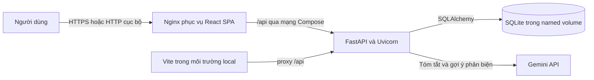

# Hệ thống quản lý hội nghị khoa học có tích hợp AI

Ứng dụng quản lý hội nghị khoa học với Backend FastAPI, giao diện React + Vite,
cơ sở dữ liệu SQLite và các chức năng AI sử dụng Gemini API.

## Chức năng chính

- Đăng nhập bằng JWT và phân quyền theo vai trò.
- Quản lý hội nghị, bài báo và tác giả.
- Quản lý hồ sơ phản biện, phân công và đánh giá.
- Quản lý phiên trình bày, đăng ký tham dự và thống kê.
- AI tóm tắt bài báo và gợi ý phản biện từ danh sách ứng viên trong hệ thống.
- API tài liệu hóa bằng Swagger UI tại `/docs`.

## Công nghệ và yêu cầu

- Windows 10/11.
- Python 3.14 (phiên bản đã dùng để kiểm thử dự án).
- Node.js 22.12 trở lên và npm (khuyến nghị Node.js 22 LTS).
- Gemini API key chỉ cần thiết nếu muốn sử dụng chức năng AI. Các API quản lý
  thông thường không cần gọi Gemini.

Cài Python từ [python.org/downloads](https://www.python.org/downloads/) và
Node.js từ [nodejs.org](https://nodejs.org/) (chọn bản 22 LTS). Sau khi cài, mở
một cửa sổ PowerShell mới và kiểm tra:

```powershell
py -3.14 --version
node --version
npm --version
```

## Cài đặt lần đầu

Mở PowerShell tại thư mục dự án:

```powershell
cd C:\HeThongQuanLyHoiNghiAI
```

### 1. Cài đặt Backend

Cài Python 3.14, sau đó tạo môi trường ảo và cài thư viện:

```powershell
cd C:\HeThongQuanLyHoiNghiAI\backend
py -3.14 -m venv .venv
.\.venv\Scripts\python.exe -m pip install --upgrade pip
.\.venv\Scripts\python.exe -m pip install -r requirements.txt
```

Tạo file cấu hình riêng từ mẫu. Lệnh sau không ghi đè `.env` nếu file đã tồn tại:

```powershell
if (-not (Test-Path .env)) {
    Copy-Item .env.example .env
}
```

Mở `backend\.env` và cấu hình `JWT_SECRET_KEY` bằng giá trị ngẫu nhiên dài tối
thiểu 32 ký tự. Có thể tạo giá trị ngẫu nhiên bằng:

```powershell
.\.venv\Scripts\python.exe -c "import secrets; print(secrets.token_urlsafe(48))"
```

Không đưa giá trị secret hoặc `GEMINI_API_KEY` vào README, mã nguồn, ảnh chụp
màn hình hay GitHub. `GEMINI_API_KEY` có thể để trống nếu chưa dùng AI. Không
chia sẻ file `.env`.

### 2. Khởi tạo SQLite và dữ liệu mẫu

```powershell
.\.venv\Scripts\python.exe .\init_db.py
```

Cơ sở dữ liệu được lưu tại `backend\conference.db`. Script dùng
`Base.metadata.create_all()` và thêm dữ liệu mẫu khi chưa có; không xóa bảng,
không thay mật khẩu người dùng đã tồn tại. Trước khi chạy lại trên một database
đang sử dụng, hãy tạo bản sao lưu theo mục **Sao lưu và khôi phục SQLite**.

### 3. Cài đặt Frontend

Mở một cửa sổ PowerShell khác:

```powershell
cd C:\HeThongQuanLyHoiNghiAI\frontend
npm ci
```

## Khởi động ứng dụng

Khởi động Backend trong cửa sổ PowerShell thứ nhất:

```powershell
cd C:\HeThongQuanLyHoiNghiAI\backend
.\.venv\Scripts\python.exe -m uvicorn main:app --reload --host 127.0.0.1 --port 8001
```

- API: <http://127.0.0.1:8001>
- Kiểm tra trạng thái: <http://127.0.0.1:8001/api/health>
- Swagger UI: <http://127.0.0.1:8001/docs>

Khởi động Frontend trong cửa sổ PowerShell thứ hai:

```powershell
cd C:\HeThongQuanLyHoiNghiAI\frontend
npm run dev -- --host 127.0.0.1 --port 5173
```

Mở <http://127.0.0.1:5173>. Vite chuyển tiếp các đường dẫn `/api` tới
`http://127.0.0.1:8001` theo cấu hình trong `frontend\vite.config.js`.

## Tài khoản và dữ liệu mẫu

`backend\init_db.py` tạo các tài khoản mẫu nếu email tương ứng chưa có:

| Email | Vai trò |
|---|---|
| `organizer@example.com` | Ban tổ chức |
| `author@example.com` | Tác giả |
| `reviewer@example.com` | Phản biện |

Mật khẩu không được ghi trong tài liệu này. Hãy lấy thông tin đăng nhập qua kênh
phân phối an toàn dành cho buổi trình diễn; không dùng các tài khoản mẫu cho môi
trường có dữ liệu thật.

Dữ liệu mẫu gồm hội nghị “Hội nghị Khoa học Công nghệ 2027”, phiên trình bày về
trí tuệ nhân tạo, một bài báo ứng dụng học máy, hồ sơ và đánh giá phản biện, đăng
ký tham dự và thông báo mẫu. Việc khởi tạo có tính lặp an toàn đối với các bản
ghi mẫu đã tồn tại.

## Kiểm thử và kiểm tra chất lượng

Các lệnh Backend dùng SQLite tạm của bộ test, không cần xóa hoặc tạo lại
`backend\conference.db`:

```powershell
cd C:\HeThongQuanLyHoiNghiAI\backend
.\.venv\Scripts\python.exe -m unittest discover -s tests -v
```

Kiểm tra lint Frontend:

```powershell
cd C:\HeThongQuanLyHoiNghiAI\frontend
npm run lint
```

Build Frontend:

```powershell
cd C:\HeThongQuanLyHoiNghiAI\frontend
npm run build
```

## Sao lưu và khôi phục SQLite

### Tạo bản sao lưu

Đóng gói bằng SQLite backup API để tạo snapshot nhất quán. Ví dụ dưới đây tạo
tên file mới theo thời gian và dừng nếu file đích đã tồn tại:

```powershell
cd C:\HeThongQuanLyHoiNghiAI
$backup = "backups\conference_$(Get-Date -Format yyyyMMdd_HHmmss).db"
New-Item -ItemType Directory -Force backups | Out-Null
@'
import sqlite3
import sys
from pathlib import Path
from contextlib import closing

source_path = Path(sys.argv[1]).resolve()
backup_path = Path(sys.argv[2]).resolve()
if not source_path.is_file():
    raise SystemExit(f"Không tìm thấy database nguồn: {source_path}")
backup_path.parent.mkdir(parents=True, exist_ok=True)
with backup_path.open("xb"):
    pass
with (
    closing(sqlite3.connect(source_path)) as source,
    closing(sqlite3.connect(backup_path)) as backup,
):
    source.backup(backup)
    result = backup.execute("PRAGMA integrity_check").fetchone()[0]
if result != "ok":
    raise SystemExit(f"Bản sao lưu không hợp lệ: {result}")
print(f"Đã tạo và kiểm tra bản sao lưu: {backup_path}")
'@ | .\backend\.venv\Scripts\python.exe - backend\conference.db $backup
```

Giữ bản sao lưu ở nơi an toàn, giới hạn quyền truy cập và không đưa nó lên GitHub.
`.gitignore` loại trừ thư mục `backups`.

### Kiểm tra khôi phục vào một file riêng

Khôi phục thử nghiệm vào một file mới, không ghi đè database đang dùng. Chọn
đúng đường dẫn backup ở lệnh đầu; lệnh Python sẽ báo lỗi nếu file đích đã tồn tại.

```powershell
cd C:\HeThongQuanLyHoiNghiAI
$backup = "backups\conference_YYYYMMDD_HHMMSS.db"
$restore = "backend\conference_restore_validation.db"
@'
import sqlite3
import sys
from pathlib import Path
from contextlib import closing

backup_path = Path(sys.argv[1]).resolve()
restore_path = Path(sys.argv[2]).resolve()
if not backup_path.is_file():
    raise SystemExit(f"Không tìm thấy bản sao lưu: {backup_path}")
with closing(sqlite3.connect(backup_path)) as backup:
    result = backup.execute("PRAGMA integrity_check").fetchone()[0]
    if result != "ok":
        raise SystemExit(f"Bản sao lưu không hợp lệ: {result}")
with restore_path.open("xb"):
    pass
with (
    closing(sqlite3.connect(backup_path)) as backup,
    closing(sqlite3.connect(restore_path)) as restored,
):
    backup.backup(restored)
    result = restored.execute("PRAGMA integrity_check").fetchone()[0]
if result != "ok":
    raise SystemExit(f"Bản khôi phục không hợp lệ: {result}")
print(f"Khôi phục thử nghiệm thành công, database gốc không bị thay đổi: {restore_path}")
'@ | .\backend\.venv\Scripts\python.exe - $backup $restore
```

Lệnh trên chỉ tạo bản khôi phục kiểm tra; ứng dụng hiện được cấu hình cố định
dùng `backend\conference.db`. Không đổi tên hoặc chép đè file này để khôi phục
khi backend còn chạy. Nếu cần phục hồi môi trường đang sử dụng, hãy dừng backend,
tạo thêm một bản sao lưu database hiện tại, kiểm tra bản khôi phục ở đường dẫn
riêng trước, rồi thực hiện thay thế thủ công theo quy trình được người quản trị
phê duyệt.

## Git và tệp không được chia sẻ

`.gitignore` loại trừ cấu hình bí mật `.env`, database `conference.db`, các file
WAL/SHM, bản sao lưu, môi trường Python `.venv`, `node_modules`, cache Python và
thư mục build Frontend. Chỉ commit `.env.example` với giá trị mẫu không bí mật.

## Triển khai bằng Docker Compose

### Điều kiện và cấu hình môi trường

Cài Docker Desktop cho Windows, bật WSL 2 backend (nếu được yêu cầu) và khởi
động Docker Desktop. Từ thư mục gốc dự án, tạo `backend\.env` nếu chưa có:

```powershell
cd C:\HeThongQuanLyHoiNghiAI
if (-not (Test-Path .\backend\.env)) {
    Copy-Item .\backend\.env.example .\backend\.env
}
```

Mở `backend\.env`, thay `JWT_SECRET_KEY` mẫu bằng chuỗi ngẫu nhiên tối thiểu 32
ký tự. Đặt `GEMINI_API_KEY` nếu cần demo hai chức năng AI; có thể để trống nếu
không dùng Gemini. Compose truyền cấu hình cho backend từ file này; Dockerfile
không chép file `.env` vào image và không có secret mặc định trong compose.
Không hiển thị hoặc commit nội dung `.env`.

### Build và khởi động

Chạy tại thư mục chứa `docker-compose.yml`:

```powershell
docker compose config --quiet
docker compose up -d --build
docker compose ps
```

Mặc định Frontend được công bố ở cổng host `5173`, Backend ở `8001`. Nếu các
cổng này đã được dùng (ví dụ ứng dụng local đang chạy), có thể chọn cổng host
khác mà không đổi cổng bên trong container:

```powershell
$env:FRONTEND_HOST_PORT = "15173"
$env:BACKEND_HOST_PORT = "18001"
docker compose up -d --build
```

Trong phiên PowerShell mới, đặt lại các biến này trước khi gọi Compose để giữ
cùng cấu hình cổng. Bỏ biến hoặc đóng phiên PowerShell để dùng lại giá trị mặc
định.

Compose build Backend FastAPI/Uvicorn và Frontend React/Vite thành static assets
được phục vụ bởi Nginx. Frontend Nginx chuyển tiếp `/api` tới service `backend`
qua mạng bridge nội bộ của Compose. SQLite được lưu trong named volume
`conference_data`, tại `/data/conference.db` bên trong container backend.
Backend chỉ tạo các bảng còn thiếu khi container khởi động; không tự seed,
reset hoặc xóa dữ liệu. Khởi tạo dữ liệu demo khi cần bằng lệnh riêng:

```powershell
docker compose exec backend python init_db.py
```

Lệnh trên dùng `init_db.py` hiện có; script thêm các bản ghi demo còn thiếu và
không thay mật khẩu người dùng đã tồn tại. Không chạy lệnh khởi tạo demo nếu
không muốn thêm dữ liệu mẫu vào volume.

### URL và kiểm tra sức khỏe

- Ứng dụng: <http://127.0.0.1:5173>
- Backend API trực tiếp: <http://127.0.0.1:8001>
- Swagger UI: <http://127.0.0.1:8001/docs>
- Health backend: <http://127.0.0.1:8001/api/health>
- Health qua Nginx: <http://127.0.0.1:5173/api/health>

Kiểm tra phản hồi và trạng thái container:

```powershell
Invoke-RestMethod http://127.0.0.1:8001/api/health
Invoke-RestMethod http://127.0.0.1:5173/api/health
docker compose ps
docker compose logs --tail 100 backend frontend
```

Để dừng ứng dụng mà vẫn giữ dữ liệu:

```powershell
docker compose down
```

Không thêm `-v` vào lệnh trên: tùy chọn đó xóa named volume SQLite. Khi chạy
lại `docker compose up -d`, dữ liệu trong `conference_data` được giữ nguyên.

### Sao lưu và khôi phục volume Docker

Tạo snapshot nhất quán bằng SQLite backup API trong container, rồi sao chép
snapshot ra thư mục `backups` trên Windows:

```powershell
cd C:\HeThongQuanLyHoiNghiAI
New-Item -ItemType Directory -Force .\backups | Out-Null
$stamp = Get-Date -Format yyyyMMdd_HHmmss
$containerBackup = "/tmp/conference_$stamp.db"
$hostBackup = ".\backups\conference_$stamp.db"
docker compose exec -T backend python -c "import sqlite3; from pathlib import Path; p=Path('$containerBackup'); p.open('xb').close(); src=sqlite3.connect('/data/conference.db'); dst=sqlite3.connect(str(p)); src.backup(dst); check=dst.execute('PRAGMA integrity_check').fetchone()[0]; dst.close(); src.close(); assert check == 'ok', check"
if ($LASTEXITCODE -ne 0) { throw "Tạo snapshot SQLite thất bại." }
docker compose cp "backend:$containerBackup" $hostBackup
if ($LASTEXITCODE -ne 0) { throw "Không sao chép được snapshot về Windows." }
Write-Host "Đã tạo snapshot tại $hostBackup"
```

Giữ file backup ở nơi riêng tư và không commit lên Git. Khi cần khôi phục, trước
hết dừng backend, tạo backup của volume hiện tại và dùng file đã xác minh để
khôi phục **vào một file mới** trong volume:

```powershell
docker compose stop backend
$restoreCandidate = "/data/conference_restore_candidate.db"
docker compose cp $hostBackup "backend:$restoreCandidate"
docker compose run --rm --no-deps --entrypoint python backend -c "import sqlite3; from pathlib import Path; src=Path('/data/conference_restore_candidate.db'); dst=Path('/data/conference_restore_validated.db'); assert src.is_file(), 'Không tìm thấy file restore'; assert not dst.exists(), 'File đích đã tồn tại'; a=sqlite3.connect(str(src)); b=sqlite3.connect(str(dst)); a.backup(b); check=b.execute('PRAGMA integrity_check').fetchone()[0]; b.close(); a.close(); assert check == 'ok', check; print(f'Bản khôi phục đã xác minh: {dst}')"
```

Lệnh chỉ tạo file `conference_restore_validated.db`; database đang dùng không
bị ghi đè. Kiểm tra bản khôi phục và backup hiện tại trước khi đưa dữ liệu vào
vận hành. Để chuyển ứng dụng sang bản khôi phục, cần dừng các container đang
dùng volume, giữ nguyên file `conference.db` cũ dưới một tên lưu trữ mới rồi
mới thay thế file hoạt động; không xóa volume. Sau thao tác, chạy lại
`docker compose up -d` và kiểm tra health cùng dữ liệu. Khi không chắc chắn, giữ
bản khôi phục ở file riêng và nhờ người quản trị thực hiện bước chuyển đổi.

### Cấu hình Docker và lưu trữ

- `backend/Dockerfile`: Python 3.14 slim, cài `requirements.txt`, chạy dưới tài
  khoản không phải root và mở cổng 8001.
- `backend/docker-entrypoint.sh`: gọi `Base.metadata.create_all()` qua hàm
  `create_database()` trước khi chạy Uvicorn; thao tác này chỉ tạo bảng thiếu,
  không gọi seed.
- `frontend/Dockerfile`: build multi-stage bằng Node.js 22 rồi phục vụ bản build
  bằng Nginx Alpine.
- `frontend/nginx.conf`: proxy `/api` tới Backend và fallback SPA về
  `index.html`.
- `docker-compose.yml`: hai service, healthcheck, restart policy, mạng bridge
  dùng chung và named volume `conference_data`.
- `DATABASE_PATH`: local mặc định vẫn là `backend\conference.db`; Compose đặt
  biến này thành `/data/conference.db`. Tất cả router lấy cùng đường dẫn từ
  `backend/database.py`.

## Giới thiệu đề tài và mục tiêu

**Nhóm 16 – Hệ thống quản lý hội nghị khoa học có tích hợp AI** hỗ trợ số hóa
các công việc chính của hội nghị: quản lý thông tin hội nghị, tiếp nhận bài báo,
phân công chuyên gia phản biện, xếp phiên trình bày, đăng ký tham dự và theo dõi
thống kê. Mục tiêu là cung cấp một ứng dụng web có phân quyền, dữ liệu nhất quán
trên SQLite và công cụ AI hỗ trợ đọc nội dung; AI không thay thế quyết định của
ban tổ chức hoặc phản biện.

## Kiến trúc



Trong triển khai Compose, trình duyệt chỉ cần truy cập Frontend; Nginx gọi
Backend trên mạng Docker riêng. API Gemini chỉ được gọi từ Backend khi người
dùng yêu cầu một trong hai chức năng AI.

## Cấu trúc thư mục

```text
.
├── backend/
│   ├── *_api.py                 # Router FastAPI theo nghiệp vụ
│   ├── models.py               # SQLAlchemy models
│   ├── database.py             # Đường dẫn SQLite
│   ├── security.py             # JWT, hash và kiểm tra quyền
│   ├── init_db.py              # Tạo bảng và seed demo an toàn
│   ├── tests/                  # unittest dùng SQLite tạm
│   ├── Dockerfile
│   ├── docker-entrypoint.sh
│   ├── requirements.txt
│   └── .env.example
├── frontend/
│   ├── src/                    # React pages, components và API client
│   ├── Dockerfile
│   ├── nginx.conf
│   ├── package.json
│   └── package-lock.json
├── backups/                    # Bản sao lưu cục bộ, không đưa lên Git
├── docker-compose.yml
└── README.md
```

## CSDL và quan hệ chính

SQLAlchemy định nghĩa các bảng trong `backend/models.py`. Khóa ngoại và unique
constraints bảo vệ các liên kết nghiệp vụ; SQLite được bật foreign keys trong
các kết nối backend.

| Bảng | Quan hệ chính |
|---|---|
| `users` | Tài khoản, hash mật khẩu và vai trò; liên kết với các nghiệp vụ người dùng |
| `conferences` | Người tạo là `users`; có nhiều bài báo, phiên và đăng ký |
| `papers` | Thuộc một hội nghị, do một user gửi; có thể gắn phiên trình bày |
| `paper_authors` | Bảng liên kết nhiều-nhiều giữa `papers` và `users`, có thứ tự tác giả |
| `reviewer_profiles` | Hồ sơ chuyên môn và giới hạn phân công, liên kết một-một với user |
| `review_assignments` | Nối bài báo với phản biện; mỗi phản biện chỉ được phân công một lần cho cùng bài |
| `reviews` | Đánh giá của một phân công; mỗi assignment có tối đa một review |
| `sessions` | Phiên trình bày thuộc hội nghị |
| `registrations` | Nối user tham dự với hội nghị; không trùng đăng ký |
| `notifications` | Thông báo và email nháp của user |

Compose dùng volume để lưu nguyên file SQLite hiện tại; không đổi schema và
không tạo một loại database mới.

## Vai trò và phạm vi quyền

| Vai trò | Quyền chính |
|---|---|
| `organizer` | Tạo/sửa/xóa hội nghị; quản lý hồ sơ và phân công phản biện; quản lý phiên; xem thống kê; gợi ý phản biện bằng AI |
| `author` | Xem hội nghị; quản lý bài báo mình gửi và tác giả bài; đăng ký tham dự; tóm tắt bằng AI bài báo mình sở hữu |
| `reviewer` | Xem phân công của mình; tạo/sửa đánh giá của mình; tóm tắt bằng AI bài báo được giao |
| `admin` | Được các dependency `require_roles` dùng chung cho phép; các kiểm tra quyền sở hữu và điều kiện riêng của endpoint vẫn được áp dụng |

Backend kiểm tra JWT, vai trò và quyền sở hữu/phạm vi bản ghi; ẩn nút trên giao
diện chỉ nhằm hỗ trợ trải nghiệm, không thay thế kiểm tra phía server.

## Hai chức năng AI Gemini

1. **Tóm tắt bài báo** – `POST /api/ai/summarize-paper/{paper_id}`. Tóm tắt
   tiếng Việt, liệt kê ý chính và từ khóa; cho phép organizer, tác giả sở hữu
   bài hoặc reviewer được phân công.
2. **Gợi ý người phản biện** – `POST /api/ai/suggest-reviewers/{paper_id}`.
   Chỉ organizer được gọi. Ứng viên lấy từ hồ sơ reviewer trong CSDL, đã loại
   tác giả và reviewer đã phân công/đạt giới hạn. Gemini nhận tiêu đề, abstract,
   keywords và mã/chuyên môn ứng viên, không cần tên đầy đủ; backend chỉ trả về
   ứng viên hợp lệ từ CSDL.

Để demo, cấu hình `GEMINI_API_KEY` trong `backend\.env` (local) hoặc cùng file
được Compose đọc. Đăng nhập đúng vai trò, mở trang Bài báo và chọn nút AI phù
hợp. Endpoint chỉ nhận JWT; thiếu key sẽ trả lỗi cấu hình rõ ràng. Lỗi mạng,
timeout và giới hạn API được trả về dưới dạng thông báo lỗi. Kết quả AI có thể
sai hoặc thiếu, cần người có chuyên môn kiểm tra; gợi ý không tự tạo phân công
và không quyết định chấp nhận/từ chối bài báo.

## Vấn đề thường gặp

| Triệu chứng | Cách kiểm tra/khắc phục |
|---|---|
| Backend dừng khi khởi động do thiếu `JWT_SECRET_KEY` | Tạo `backend\.env` từ `.env.example`, đặt secret ngẫu nhiên tối thiểu 32 ký tự; không dùng chuỗi mẫu |
| Compose báo thiếu `backend/.env` | Tạo file theo bước cấu hình Docker, không đổi hoặc xóa file `.env` đang dùng |
| Frontend không gọi được API / Nginx trả 502 | Kiểm tra `docker compose ps`, backend health và `docker compose logs backend frontend`; đảm bảo cả hai service ở cùng compose network |
| Cổng 5173 hoặc 8001 đã được dùng | Dừng tiến trình đang chiếm cổng hoặc đổi host port trong `docker-compose.yml`, giữ nguyên cổng container |
| Backend unhealthy | Xem logs; kiểm tra secret, quyền ghi named volume và kết quả khởi tạo bảng |
| AI trả 503 | Cấu hình `GEMINI_API_KEY` rồi tạo lại backend: `docker compose up -d --force-recreate backend` |
| AI trả 429 hoặc timeout | Đợi giới hạn Gemini được gỡ, kiểm tra mạng và thử lại; không bấm lặp trong khi đang tải |
| Không thấy dữ liệu demo trong Compose | Chạy `docker compose exec backend python init_db.py` có chủ ý; lệnh này seed bản ghi mẫu còn thiếu |
| Đã chạy `docker compose down` và lo dữ liệu mất | `down` không xóa named volume; chạy `docker compose up -d`. Tuyệt đối không dùng `down -v` nếu muốn giữ SQLite |

## Đưa code lên GitHub

1. Kiểm tra `git status` và xác nhận `backend/.env`, `backend/conference.db`,
   `backups/`, `.venv` và `node_modules` không nằm trong danh sách sẽ commit.
2. Không dùng `git add -f` cho secret, database hay bản sao lưu. Chỉ chia sẻ
   `.env.example` với giá trị mẫu.
3. Thêm các thay đổi cần thiết, xem lại staged diff rồi commit:

```powershell
git status --short
git add README.md .gitignore docker-compose.yml backend/Dockerfile backend/docker-entrypoint.sh backend/.dockerignore backend/database.py frontend/Dockerfile frontend/nginx.conf frontend/.dockerignore
git diff --cached --check
git diff --cached --stat
git commit -m "Add Docker deployment and technical documentation"
git push
```

Không đưa dữ liệu cá nhân hoặc nội dung backup lên repository công khai; dùng
repository riêng tư và quy trình quản lý secret phù hợp cho môi trường triển khai.

## Đối chiếu 10 tiêu chí bảo vệ

Chưa tìm thấy rubric chính thức trong workspace. Bảng dưới đây là bảng tham chiếu
theo các hạng mục kỹ thuật của đề tài; nếu rubric của giảng viên đặt tên/đánh số
khác, hãy đối chiếu lại với bản rubric chính thức.

| # | Hạng mục tham chiếu | Chức năng hoặc minh chứng trong dự án |
|---:|---|---|
| 1 | Phân tích đề tài và yêu cầu | README mô tả mục tiêu, vai trò và luồng quản lý hội nghị khoa học |
| 2 | Kiến trúc hệ thống | Mermaid: React/Vite, Nginx, FastAPI, SQLite và Gemini |
| 3 | Thiết kế CSDL | SQLAlchemy models, khóa ngoại, unique/check constraints và bảng quan hệ được liệt kê ở trên |
| 4 | Giao diện người dùng | React responsive, đăng nhập, dashboard, menu theo role, CRUD và modal AI |
| 5 | Chức năng nghiệp vụ/API | Router hội nghị, bài báo/tác giả, phản biện, phiên, đăng ký và thống kê |
| 6 | Bảo mật | JWT, hash mật khẩu, kiểm tra vai trò/quyền sở hữu; secret trong `.env`, không trong frontend |
| 7 | Độ ổn định và kiểm thử | Backend `unittest` dùng SQLite tạm; frontend lint/build; xử lý lỗi và timeout Gemini |
| 8 | Triển khai và đóng gói | Docker Compose, multi-stage frontend build, Nginx reverse proxy, healthcheck và SQLite named volume |
| 9 | Tài liệu kỹ thuật | README cài đặt local/Docker, cấu hình, vận hành, sao lưu/khôi phục và xử lý sự cố |
| 10 | Tích hợp AI | Gemini tóm tắt bài báo và gợi ý reviewer có kiểm tra ứng viên; AI chỉ là hỗ trợ |
